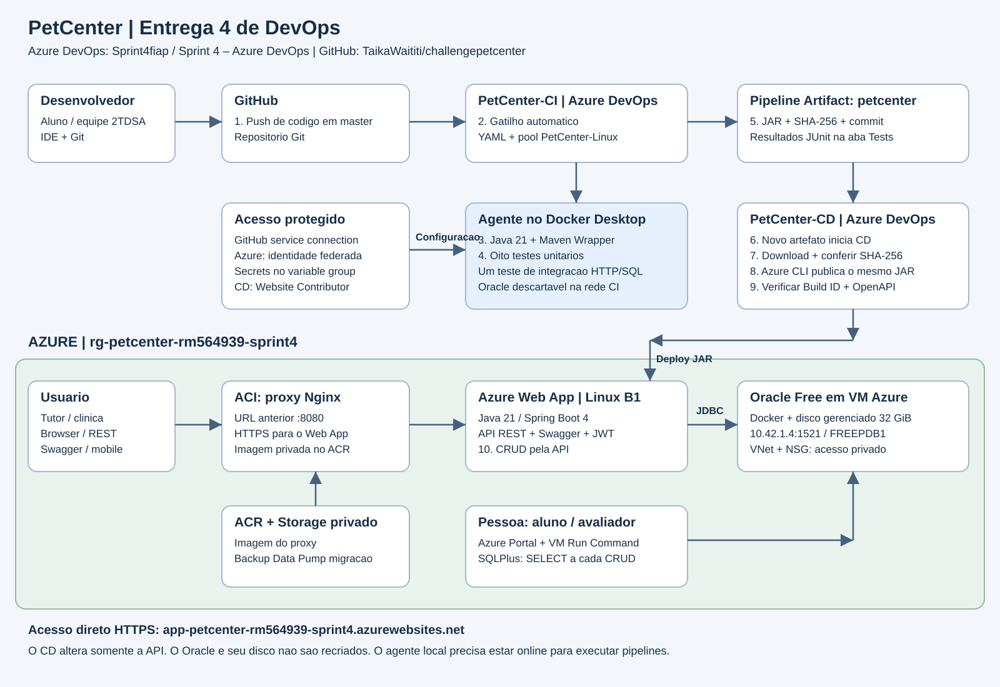

# PetCenter — Entrega 4 de DevOps

PetCenter é uma API REST para acompanhar a saúde, o humor e a rotina dos pets. Tutores registram animais e diários; clínicas e veterinários consultam o histórico para apoiar a continuidade do cuidado. Esta entrega utiliza **Java, banco de dados na Azure e CI/CD no Azure DevOps**.

## Links da entrega

| Destino | Link |
|---|---|
| GitHub | [TaikaWaititi/challengepetcenter](https://github.com/TaikaWaititi/challengepetcenter) |
| Azure DevOps | [Sprint4fiap / Sprint 4 – Azure DevOps](https://dev.azure.com/Sprint4fiap/65b112f9-8fca-499e-93fc-86127fc2f2f6) |
| CI | [PetCenter-CI](https://dev.azure.com/Sprint4fiap/65b112f9-8fca-499e-93fc-86127fc2f2f6/_build?definitionId=1) |
| CD | [PetCenter-CD](https://dev.azure.com/Sprint4fiap/65b112f9-8fca-499e-93fc-86127fc2f2f6/_build?definitionId=2) |
| API em nuvem | [Página inicial e Build ID](https://app-petcenter-rm564939-sprint4.azurewebsites.net/) |
| Swagger em nuvem | [Swagger UI](https://app-petcenter-rm564939-sprint4.azurewebsites.net/swagger-ui.html) |
| OpenAPI | [Especificação JSON](https://app-petcenter-rm564939-sprint4.azurewebsites.net/api-docs) |
| Vídeo YouTube | **Pendente: inserir o link após a gravação narrada pelo grupo.** |

## Equipe e professor

| RM | Integrante | Turma |
|---|---|---|
| RM566515 | Arthur dos Santos Cabral | 2TDSA |
| RM564975 | Julia Tiziotto Buttler | 2TDSA |
| RM566357 | Mariana Xavier Quispe | 2TDSA |
| RM564939 | Bruno Martins Bettio | 2TDSA |
| RM562341 | Jose Diogo Da Silva Neves | 2TDSA |

Professor: **Felipe Cavalcante Vilella de Oliveira — pf2128@fiap.com.br**, configurado com acesso **Basic** e membro de **Project Administrators**.

## Stack e função das ferramentas

| Camada | Tecnologias | Função |
|---|---|---|
| Aplicação | Java 21, Spring Boot 4.0.6, Spring MVC | API REST e regras de negócio |
| Persistência | Spring Data JPA/Hibernate, Oracle JDBC | Acesso ao banco e relacionamentos |
| Validação e segurança | Bean Validation, Spring Security, JWT | Validar entradas e autenticar rotas |
| Documentação REST | Swagger UI / OpenAPI | Contratos e chamadas HTTP |
| Build e testes | Maven Wrapper, JUnit, Mockito | Compilação, testes e JAR |
| Versionamento | Git e GitHub | Código e push na branch master |
| CI/CD | Azure DevOps / Azure Pipelines YAML | Build, testes, artefato e deploy automático |
| Agente | Linux em Docker Desktop, pool PetCenter-Linux | Execução dos jobs |
| Integração no CI | Oracle Free em container Docker descartável | Teste HTTP/SQL em banco real isolado |
| Aplicação na Azure | Azure Web App Linux, plano Basic B1 | Execução do JAR publicado |
| Banco na Azure | Oracle Database Free em Docker numa VM Azure | Persistência da aplicação |
| Rede e disco | Azure VNet, NSG e disco gerenciado de 32 GiB | Conexão privada e dados persistentes |
| Compatibilidade | ACI e Nginx | Proxy da URL anterior para o Web App |
| Imagens e backup | Azure Container Registry e Blob Storage privado | Imagem do proxy e backup Data Pump |
| Deploy e SQL | Azure CLI, identidade federada, VM Run Command e SQLPlus | Publicação e consultas no Oracle da nuvem |

## Arquitetura e fluxo CI/CD



[Abrir o diagrama completo](docs/arquitetura-sprint4.svg).

Personas: **desenvolvedor/aluno**, que altera e publica código; **usuário final**, que acessa API/Swagger ou seus clientes; **aluno/avaliador**, que acompanha pipelines, Portal Azure e consultas SQL.

1. Desenvolvedor faz commit e push em master no GitHub.
2. O webhook inicia automaticamente PetCenter-CI no Azure DevOps.
3. O agente Linux seleciona Java 21 e cria um Oracle descartável na rede Docker petcenter-ci.
4. Maven executa `clean verify -Poracle-it`: oito testes unitários e um teste de integração HTTP/SQL.
5. O CI publica resultados JUnit na aba **Tests** e o Pipeline Artifact **petcenter** no Azure DevOps.
6. O sucesso do CI em master, com o novo artefato, inicia automaticamente PetCenter-CD.
7. O CD baixa o artefato daquela execução e confere o SHA-256 do JAR.
8. A service connection federada autentica na Azure; Azure CLI publica o mesmo JAR no Web App.
9. O CD aguarda publicação/inicialização e verifica o Build ID, a API e o OpenAPI.
10. O usuário acessa a API. O aluno demonstra CRUD e SELECTs no Oracle em nuvem em cada operação.

O acesso principal usa HTTPS no Web App. A URL anterior, `http://petcenter-rm564939-sprint4.brazilsouth.azurecontainer.io:8080/`, é mantida pelo ACI/Nginx, com conexão HTTPS e certificado verificado até o Web App. O ACR armazena a imagem do proxy. Os cabeçalhos encaminhados preservam o endereço usado pelo Swagger.

### Banco de dados em nuvem

O Oracle está na VM **vm-petcenter-oracle**, no grupo **rg-petcenter-rm564939-sprint4**. O container monta `/srv/petcenter/oradata` em `/opt/oracle/oradata`; `/srv/petcenter` está em disco de dados gerenciado. A aplicação acessa FREEPDB1 em `10.42.1.4:1521` pela VNet integrada ao Web App. O NSG permite essa conexão pela subnet da aplicação e bloqueia acesso público ao banco.

O CD atua somente no Web App e não recria o Oracle nem seu disco. Os dados anteriores foram migrados com Data Pump, backup privado, conferência de hash e comparação das 12 tabelas. O Oracle descartável do CI serve exclusivamente aos testes.

## Configuração do projeto Azure DevOps

| Propriedade | Configuração |
|---|---|
| Organization | Sprint4fiap |
| Project Name | Sprint 4 – Azure DevOps |
| Description | Projeto para entrega da Sprint 4 do professor Felipe Cavalcante Vilella de Oliveira, seguido dos RMs, nomes e turmas da equipe |
| Visibility | Private |
| Version control | Git |
| Work item process | Scrum |
| Professor | Basic e Project Administrators |
| Repositório conectado | GitHub TaikaWaititi/challengepetcenter |
| Branch do gatilho CI | master |
| Pool / environment | PetCenter-Linux / petcenter-sprint4 |

**master é uma branch**; o usuário do GitHub é TaikaWaititi. A main acompanha a versão publicada. Alterar somente main não dispara esse CI. O projeto anterior de Compliance/Boards na organização RM564975 foi preservado.

## Pipelines: jobs, tasks e artefato

### CI — PetCenter-CI

Configuração: [azure-pipelines.yml](azure-pipelines.yml), com gatilho por push em master e validação de PRs desativada para este agente.

| Task/etapa | O que executa e publica |
|---|---|
| Checkout e Selecionar Java 21 | Obtém o commit e configura JAVA_HOME_21_X64 |
| Build e testes com Oracle isolado | [test-oracle.sh](scripts/ci/test-oracle.sh): credenciais aleatórias, Oracle isolado e Maven |
| PublishTestResults@2 | Publica `target/*-reports/TEST-*.xml`; falha com testes reprovados ou relatórios ausentes |
| Empacotar JAR testado e scripts | app.jar, SHA256SUMS, build-id.txt, commit.txt, Dockerfile de runtime e scripts de deploy/smoke |
| PublishPipelineArtifact@1 | Publica o artefato petcenter no Azure DevOps |

Os oito testes unitários cobrem serviço de pets e JWT. A integração inicia a aplicação real, cadastra usuário, autentica, faz CRUD de pet por HTTP e confere os dados por SQL no Oracle. Ao terminar, o script remove somente o Oracle criado para aquela execução.

### CD — PetCenter-CD

Configuração: [azure-pipelines-cd.yml](azure-pipelines-cd.yml). O recurso ci, vinculado a PetCenter-CI, dispara após sucesso em refs/heads/master. O job de deployment usa o environment petcenter-sprint4.

| Task/etapa | O que executa e verifica |
|---|---|
| Download do recurso ci | Baixa petcenter do CI de origem; não recompila Java |
| AzureCLI@2 | Autentica com sc-petcenter-azure e executa [deploy-webapp.sh](scripts/ci/deploy-webapp.sh) do artefato |
| Conferência e deploy | Valida variáveis, confere SHA-256, configura o Web App e publica app.jar com OneDeploy |
| Verificação da aplicação | Aguarda o Build ID esperado e executa [smoke.sh](scripts/ci/smoke.sh) para API/OpenAPI |

O destino do deploy é **Azure Web App**, previsto no enunciado. O ACI funciona como proxy de compatibilidade; o CD não substitui o banco.

### Proteção dos dados sensíveis

- sc-petcenter-github: credencial armazenada na service connection, autorizada para CI/CD.
- sc-petcenter-azure: Workload Identity Federation com identidade gerenciada, sem senha permanente de service principal; autorizada somente para CD.
- Identidade de deploy: **Website Contributor somente no Web App**, sem permissão para recriar a VM do banco.
- Variable group petcenter-sprint4: SPRING_DATASOURCE_URL, SPRING_DATASOURCE_USERNAME, SPRING_DATASOURCE_PASSWORD e JWT_SECRET **secretos**; acesso somente pelo CD.
- RESOURCE_GROUP e WEBAPP_NAME identificam o destino e não contêm credenciais.
- CI usa credenciais descartáveis e não recebe os segredos do banco da aplicação.
- .env, tokens, backups e arquivos de infraestrutura com credenciais ficam fora do Git. Na gravação, mostrar somente nomes das variáveis e permissões.

### Agente necessário às execuções

O agente petcenter-azuredevops-agent roda em Docker Desktop no computador da equipe. **Computador, Docker Desktop e agente devem ficar ligados para executar pipelines e gravar o vídeo.** Aplicação e Oracle permanecem na Azure independentemente do agente.

```powershell
docker ps --filter name=petcenter-azuredevops-agent
docker start petcenter-azuredevops-agent
```

O segundo comando inicia o agente se estiver parado. Para reconstrução/registro, consultar [start-agent.ps1](scripts/azure/start-agent.ps1), [azure/agent](azure/agent) e o [guia operacional](docs/ENTREGA4_DEVOPS.md). Exige autenticação e permissões no Azure DevOps; o token temporário fica em tmp, ignorado pelo Git.

## Evidências de validação

Validação em **04/11/2026**, anterior a esta revisão de documentação:

| Evidência | Resultado |
|---|---|
| [CI 8 — ci-20261104.6](https://dev.azure.com/Sprint4fiap/65b112f9-8fca-499e-93fc-86127fc2f2f6/_build/results?buildId=8) | Succeeded, motivo individualCI, nove testes aprovados e artefato publicado |
| [CD 9 — cd-20261104.3](https://dev.azure.com/Sprint4fiap/65b112f9-8fca-499e-93fc-86127fc2f2f6/_build/results?buildId=9) | Succeeded, motivo resourceTrigger, publicação automática do artefato do CI 8 |
| Aplicação desse fluxo | Página inicial identificou build 8; API, Swagger e OpenAPI responderam HTTP 200 nas duas URLs |
| CRUD no Web App/Oracle da VM | 14 verificações HTTP e sete SELECTs aprovados; registros de teste removidos |
| Persistência após CD 9 | Contagens das 12 tabelas preservadas e Oracle sem reinício do container |

O Build ID público muda nas próximas publicações. As execuções acima permanecem identificáveis. O CD 7 foi cancelado durante a espera da publicação e pertence ao histórico; a evidência automática concluída utilizada aqui é o CD 9. O vídeo deve demonstrar uma nova alteração visível no código e seu fluxo automático completo.

## Demonstração de CRUD e SELECT na nuvem

Cadastro: POST /api/users. Login: POST /api/auth/login. Rotas protegidas recebem `Authorization: Bearer <token>`. CRUDs: /api/pets, /api/diarioentradas e /api/registros. Consultar payloads no Swagger.

O roteiro interativo cria usuário exclusivo, autentica, realiza CRUD de pet e pausa em cada operação para mostrar o SELECT:

```powershell
.\scripts\demo-crud-sprint4.ps1 -BaseUrl 'https://app-petcenter-rm564939-sprint4.azurewebsites.net'
```

Em outro terminal autenticado no Azure CLI, com permissão de Run Command na VM, substituir 123 pelo ID do pet exibido:

```powershell
az login
.\scripts\azure\select-oracle.ps1 -Query 'SELECT id, user_id, nome, especie FROM pets WHERE id = 123;'
```

O script executa SQLPlus no Oracle da **VM Azure**, sem expor senha nem abrir a porta do banco para a internet. Também é possível usar Run Command no Portal Azure.

| Operação | Evidência SQL esperada |
|---|---|
| Inserir | Uma linha com ID e nome cadastrados |
| Consultar | A mesma linha, correspondente ao retorno da API |
| Atualizar | A linha mostra o novo nome |
| Excluir | O SELECT pelo mesmo ID retorna zero linhas |

Mostrar e explicar o SELECT em **cada** etapa. Respostas HTTP isoladas não comprovam a persistência exigida. O roteiro limpa pet e usuário ao concluir com sucesso; se interrompido, consultar os IDs exibidos antes de repetir.

## Roteiro do vídeo demonstrativo

Preparar IDE, GitHub, Azure DevOps, Portal Azure, Swagger e terminal SQL; manter o agente online e verificar áudio/imagem.

1. Apresentar a aplicação, stack e diagrama: componentes, personas, conexões e ordem do fluxo.
2. Mostrar projeto privado, acesso Basic do professor e conexão com o repositório.
3. Abrir YAMLs e explicar gatilhos, jobs/tasks, artefato, variáveis protegidas e destino do deploy.
4. Alterar o texto em src/main/java/com/fiap/challengepetcenter/controller/HomeController.java, na branch master; fazer commit e push.
5. Mostrar o **CI iniciando automaticamente** para o commit enviado. Explicar build, testes, aba Tests e artefato publicado.
6. Mostrar o **CD iniciando automaticamente após o CI**, artefato de origem, checksum, autenticação e deploy. Não clicar em Run pipeline para demonstrar esses gatilhos.
7. Mostrar o Web App atualizado no Portal Azure e acessar a URL pública com novo texto e Build ID.
8. Executar CRUD completo, intercalando chamadas REST e SELECTs na nuvem para inserir, consultar, atualizar e excluir.
9. Revisar e publicar a gravação no YouTube com acesso permitido ao professor; inserir o link neste README e no PDF.

Vídeo: **mínimo 720p, áudio claro, sem legendas e explicação pela voz do aluno**, sem limite fixo de duração. Alterar somente README não substitui a mudança de código da demonstração. Gravação e PDF com link do YouTube continuam pendentes do grupo.

## Correspondência com o enunciado

Referência: páginas físicas 48–55 do Challenge 2026, capítulo DevOps Tools & Cloud Computing, Entrega 4.

| Requisito | Documentação/evidência |
|---|---|
| p.48 — Java, banco em nuvem e Azure DevOps/Azure | Descrição, stack, arquitetura e links |
| p.49, item 1 — solução e stack | Abertura e tabela de tecnologias |
| p.49, item 2 — arquitetura, personas, ferramentas e conexões | Diagrama e fluxo numerado 1–10 |
| p.49, item 3 — banco permitido em nuvem | Oracle em container na VM Azure e SELECTs |
| p.49, item 4; p.50, item 5 — projeto e Basic do professor | Configuração do projeto e equipe |
| p.50, item 6, regras I–VII — repositório, gatilhos, segredos, testes, artefato e deploy | YAMLs, tasks e evidências CI 8/CD 9 |
| p.51–52 — vídeo narrado e CRUD com SELECT | Roteiro e comandos de demonstração |
| p.48 — PDF com integrantes/turmas e links | Orientações de submissão abaixo |

Diagrama e vídeo têm, respectivamente, até 20 e 80 pontos no enunciado. A documentação apoia a entrega; o grupo ainda precisa produzir e revisar a gravação exigida.

## Desenvolvimento e testes locais

Requisitos: Java 21 e Docker com Linux containers. O ambiente local serve ao desenvolvimento; a demonstração avaliada utiliza a aplicação e o banco na nuvem.

```powershell
.\scripts\new-local-env.ps1
docker compose up -d --build
```

O gerador cria .env ignorado pelo Git com credenciais aleatórias e não sobrescreve arquivo existente. Alterar .env não troca credenciais de um volume Oracle já inicializado; preservar dados e credenciais existentes.

API local: http://localhost:8080/; Swagger: http://localhost:8080/swagger-ui.html.

Testes unitários:

```powershell
.\mvnw.cmd -B -ntp clean verify
```

Fluxo do CI, em Bash/Linux ou Git Bash, com Java 21 e Docker:

```bash
bash scripts/ci/test-oracle.sh
```

Localmente o script usa porta livre; no agente, a rede Docker petcenter-ci. Relatórios: target/surefire-reports e target/failsafe-reports.

## Submissão e documentação complementar

O **PDF final deve conter somente** nome completo, RM e turma de cada integrante e links GitHub, YouTube e Azure DevOps. Descrição, stack, arquitetura e instruções estão neste README. Conferir o acesso do professor ao projeto e ao vídeo antes de enviar.

- [Guia operacional e recursos Azure](docs/ENTREGA4_DEVOPS.md).
- [Arquivos alterados, razões e etapas do PDF](docs/ALTERACOES_SPRINT4.md).
- [Diagrama completo](docs/arquitetura-sprint4.svg).

Os relatos anteriores de preparação, testes manuais e migração são históricos. A documentação ativa é este README e o guia operacional. Os requisitos próprios das outras disciplinas devem ser demonstrados em suas entregas correspondentes.
